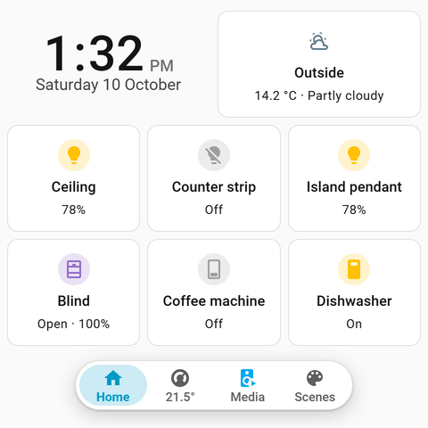
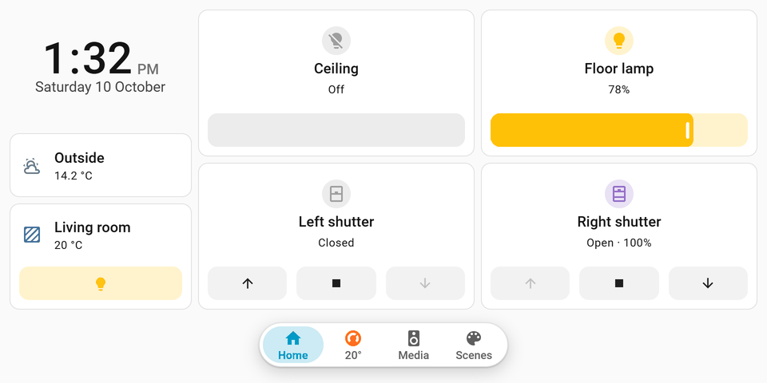
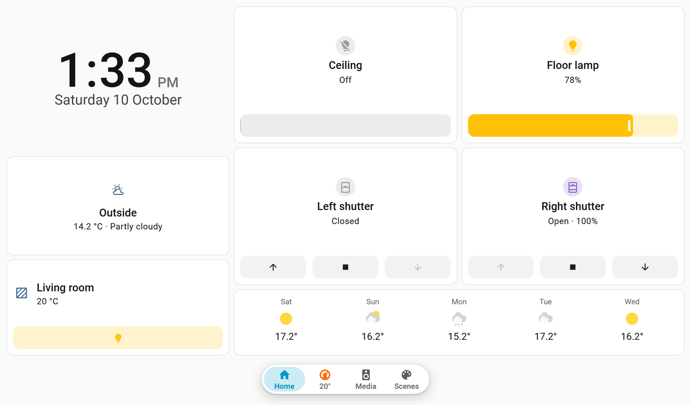

# Wall Display Dashboards
auto generated ha dashboards for wall displays. made it bc building a dashboard for a 4" shelly display by hand is pain and doing it for every room is even worse.

you tell it which display hangs in which room and it builds a dashboard that fits that exact screen. no scrolling, nothing cut off, and it updates itself when you add/move devices. works great with [ShellyElevate](https://github.com/RapierXbox/ShellyElevate) but any android panel / tablet works too.

how: the dashboard only stores "wall display, entry xyz". every time it opens, the integration looks at the room and builds the whole layout for that screen size. so theres nothing to maintain.

needs home assistant 2026.10+. no warranty, use at your own risk.

| shelly wall display 480x480 | shelly x2 landscape 960x480 |
|---|---|
|  |  |



### what it does
- tiles come from the area the display is in, new devices just show up
- pill nav at the bottom: home, climate (full screen thermostat), media, scenes. pages only show if the room has stuff for them
- every entity only shows up once (thermostat is on climate, not also on home etc)
- locks, alarms, garage doors etc are status only, tap opens the details. no accidental garage opening
- kiosk mode, scroll lock, goes back to home after 60s idle, dark mode after sunset
- entrance role for the panel at the front door: whos home, lights on, open doors/windows, all off / away
- pushes the dashboard url to shellyelevate automatically
- measures the real screen size and tells you if the model you picked is off
- english + german

### what its for
- a small panel in every room that just shows that rooms lights, blinds, heating, speaker and scenes. set up once, never touch it again
- the panel at the front door: whos home, did i leave lights on, is a window open, all off on the way out
- an old tablet on the kitchen wall as a room remote
- lots of rooms: 10 displays = 10 entries, no copy pasting yaml between dashboards

not for: a big "whole house" dashboard on your phone. ha's own dashboards do that fine.

### displays
shelly wall display, x1i, x2/x2i (landscape + portrait), xl/xli, nspanel pro, tablets, or custom size. sizes are css px not physical px. the shelly ones are guesses until the display measured itself once, see below.

| model | layout size (css px) |
|---|---|
| shelly wall display (4") | 480x480 |
| shelly wall display x1i | 480x480 |
| shelly wall display x2 / x2i landscape | 960x480 |
| shelly wall display x2 / x2i portrait | 480x960 |
| shelly wall display xl / xli | 1280x752 |
| sonoff nspanel pro | 480x480 |
| tablet landscape (8–10") | 1280x800 |
| tablet portrait (8–10") | 800x1280 |
| custom | whatever you type, 240–2560 |

works on anything that can open a ha dashboard in a browser: shellyelevate, stock shelly firmware (its home assistant screen), fully kiosk, the companion app, a browser in kiosk mode.

doesnt work on displays that dont run a real browser: esphome / lvgl screens, the old nspanel (non pro), e-ink stuff. those cant show a ha dashboard at all.

it also doesnt control the display hardware (screen on/off, brightness, relays). thats the shelly integration or the [shellyelevate integration](https://github.com/RapierXbox/shellyelevateintegration).

### install
you need [hacs](https://hacs.xyz) (or copy it by hand) and ha 2026.10 or newer.

[](https://my.home-assistant.io/redirect/hacs_repository/?owner=RapierXbox&repository=walldisplay-dashboards&category=integration)

click that, download, restart ha. or by hand in hacs: menu (⋮) → custom repositories → add `https://github.com/RapierXbox/walldisplay-dashboards` as integration

manual: copy `custom_components/walldisplay_dashboards` to `/config/custom_components/`, restart ha

### setup
1. make a non admin user for the panels (settings → people → add person, allow login on, admin off). one user for all panels is fine. admins dont get auto dark and size measuring (except in shellyelevate, that always counts as panel)
2. [](https://my.home-assistant.io/redirect/config_flow_start/?domain=walldisplay_dashboards) or settings → devices & services → add integration → wall display dashboards. one entry per display:
   - name: `Kitchen` → dashboard is `/wall-kitchen`. cant change it later
   - display device (optional): your shelly / shellyelevate device. area gets taken from it, its temp/humidity sensors get used, url gets pushed to it
   - area: the room. can be empty if the device has one
   - display model + role (room or entrance)
   - display host (optional): ip of a shellyelevate display thats not in ha, url gets pushed via http api
   - weather (optional), otherwise first weather entity
   - picked custom size? next step asks width + height in css px (what the browser reports, so a 720px screen at 1.5x is 480)
3. get the display to open it:
   - shellyelevate with the [ha integration](https://github.com/RapierXbox/shellyelevateintegration) or display host set: nothing to do
   - everything else: you get a notification with the url. stock shelly firmware → settings → network → home assistant, fully kiosk → start url, companion app → just open it as the panel user
   - url comes from settings → system → network (local url), check that if the display cant connect
4. let it load once as the panel user. if the **Measured viewport** sensor differs from your model you get a repair, submit it and it uses the real size

### options
configure on the entry, saving rebuilds the dashboard and reloads the display:
- **favourite scenes**: up to 2 scenes/scripts, first on the scenes page
- **role**: room (default) or entrance
- **extra pages**: climate, media, scenes (all on by default). a page only shows if the room has stuff for it, scenes needs 3+, fewer stay on home. page off → its stuff goes back on home
- **return home after**: seconds without touch till it goes back to home. default 60, 0 = off
- **kiosk mode**: builtin (hides header + sidebar on this dashboard only, default) / kiosk-mode plugin / off
- **pinned tiles**: first on home, in that order. can be from any room, not just the displays own
- **hidden entities**: never shown on this dashboard
- **max home tiles**: 0 = as many as fit (default). otherwise home shows at most that many, the last one turns into "+N more"
- **show the displays own entities**: off by default, so the displays screen light, relay, mute + night mode switches dont end up as tiles. pin one (eg the relay) to get just that one back
- **climate page thermostats**: thermostats from any room, first one is the big one. replaces the rooms own on the climate page, so you get a climate page even if the room has no thermostat
- **room temperature / room humidity**: the sensor for the room card, the climate page and the pill (temperature only). empty = the areas sensor (area settings), then the displays own, then any sensor in the room
- **show in sidebar**: on by default

reconfigure for area, model, device, host, weather. name stays.

### what you get
per display:
- **dashboard** at `/wall-<name>`, listed in settings → dashboards (sidebar optional)
- **device** named like the display, model = the display model you picked, visit opens the dashboard. its a service device for the dashboard, not your actual shelly
- **Measured viewport** sensor (diagnostic) on that device: what the screen really reported, like `480x480@1.5`. attributes: width, height, dpr, user agent, device, the size of the model you picked and if it matches (±4px). keeps its value over restarts
- **repairs**:
  - *display size differs from the chosen model* (`viewport_mismatch`): the screen reported another size. submit and it lays out for the measured size
  - *<name> has nothing to show* (`empty_room`): the area has no lights, covers, climate, media or scenes. put devices in the area or pick another one. goes away by itself
- **diagnostics**: entry menu (⋮) → download diagnostics. has the entry settings (display host blanked), screen size, last measured viewport, how the url got pushed and what got generated (pages, card counts, rows). no entity states. attach that when you open an issue
- a **notification** with the url if it cant push it to the display

no actions/services of its own.

### how it updates
no polling, it doesnt talk to your devices. it reads ha's areas/devices/entities.
- the dashboard gets built fresh every time it opens (page load / refresh), always from the current area
- open dashboards rebuild by themselves ~5s after you add, move, rename, hide or delete an entity, device, area or floor, and when you change ha's language. only the ones whose layout actually changed: a rename in another room doesnt make the panels redraw
- saving options, reconfigure or a repair reloads the entry: open dashboards rebuild and shellyelevate gets told to reload the page
- states (light on, temps, whats playing) are live like on any ha dashboard
- stuff that only changes in the state, not the registry (eg a thermostat getting new modes), shows up on the next page load
- screen size gets measured once per page load
- the url gets pushed on setup and again only when you change display device or host

### examples
**wake the shellyelevate display on motion.** the [shellyelevate integration](https://github.com/RapierXbox/shellyelevateintegration) gives the display a wake button. when the screen turns on the dashboard jumps to home by itself, so you always wake up on home:
```yaml
alias: kitchen display wakes on motion
triggers:
  - trigger: state
    entity_id: binary_sensor.kitchen_motion
    to: "on"
actions:
  - action: button.press
    target:
      entity_id: button.kitchen_display_wake  # your displays wake button
mode: single
```

**show the media page when music starts** (shellyelevate integration again). the return home timer still kicks in after:
```yaml
alias: kitchen display shows music
triggers:
  - trigger: state
    entity_id: media_player.kitchen
    to: playing
actions:
  - action: shellyelevateintegration.navigate
    data:
      device_id:
        - your_display_device_id
      path: /wall-kitchen/media
mode: single
```

**pin + hide.** options → pinned tiles: ceiling light, then blinds → those two are always first on home. hidden entities: the fridge plug nobody should turn off. pins can come from any room too, like the hallway light on the panel next to the bedroom door.

**entrance panel.**
1. add the hallway display with role entrance
2. make a script (or scene) called `All off` (`Alles aus` works too)
3. scenes without an area, like `Away`, show up next to it
4. home now has: people, lights on (count), open doors/windows (count), locks + alarm (status only), all off, away. the hallways own devices come after that

### editing by hand
the dashboard gets generated every time it opens so you cant edit it in the editor. dashboard menu → edit → **take control** and its a normal dashboard, integration leaves it alone after that. removing the entry wont delete a dashboard you took control of. want the generated one back? delete the dashboard and reload the entry.

### limits
- one area per display. media and scenes pages only show the displays own room, climate too unless you pick thermostats in the options
- pinned tiles can be from any room, everything else on home comes from the displays own room
- the displays own entities (screen light, relay etc) arent tiles unless you pin them or turn on show the displays own entities
- entities without an area (own or via device) dont show up. exception: scenes without an area are on every scenes page
- config/diagnostic, hidden and disabled entities never show up
- locks, alarms, valves, sirens, garage/gate/door covers are always status only, on purpose
- max 2 favourite scenes. scenes page needs 3+ scenes
- too many tiles for the screen → they go on a "+N more" page
- name / url cant change after setup
- labels only in english + german, everything else gets english
- size measuring + auto dark only for non admin users or in shellyelevate
- auto dark changes the theme of the panel user, so all panels on that user switch together
- url push only automatic for shellyelevate, everything else you type the url once
- generated dashboards cant be edited, only taken over (then they stop updating)

### problems
- **"Wall display dashboard unavailable"**: generator failed, check the ha log. still broken → open an issue with the diagnostics download
- **layout wrong size**: check the measured viewport sensor + repairs. only measures as non admin or in shellyelevate
- **size repair keeps coming back**: the display reports different sizes (zoom, rotation, different user/browser). fix the zoom, or submit the repair for the size it uses normally
- **"has nothing to show" repair**: area has nothing it can show. put devices in the area or reconfigure to another area
- **"a dashboard with this address already exists" on setup**: some other dashboard already uses `/wall-<name>`, pick another name
- **entry wont load, "address /wall-… is already used"**: someone made a dashboard/panel with that url after setup. remove that one, then reload the entry
- **"this area no longer exists" in reconfigure**: the area got deleted, pick another one
- **dark mode on other devices**: auto dark uses ha's theme setting which is saved on the user. if all panels share one user and someone changes the theme by hand it changes on all of them till next sunrise/sunset. use separate users if that bugs you
- **need header/sidebar on a panel**: add `?disable_km` to the url (admins can also use `?edit=1`)
- **kiosk-mode plugin option does nothing**: yeah you need to install and configure [kiosk-mode](https://github.com/NemesisRE/kiosk-mode) yourself then
- **device missing**: put it (or its device) in the area, check its not hidden or disabled. thermostats/speakers/scenes are on their page, not home
- **scenes page missing**: needs 3+ scenes in the room and the page turned on
- **new device doesnt show up**: open dashboards rebuild a couple secs after the change, if not just reload the page
- **display didnt get the url**: its in the notifications, enter it by hand or set display host

### remove
1. settings → devices & services → wall display dashboards → delete every entry (⋮ → delete). the generated dashboards go with them
2. hacs → wall display dashboards → ⋮ → remove, restart ha. manual install: delete `/config/custom_components/walldisplay_dashboards`, restart

dashboards you took control of stay, theyre yours. their nav pill is a card from this integration so it breaks once its gone. delete them by hand in settings → dashboards if you want.

the display still opens `/wall-<name>`, give it a new start url. the panel user stays too, delete it in settings → people if you dont need it anymore.

### dev
```bash
pip install pytest-homeassistant-custom-component==0.13.371
pytest -q tests
```
ha test stuff doesnt run on windows, use wsl or docker:
```bash
docker run --rm -v "$PWD:/repo" -w /repo python:3.14 sh -c "pip install -q pytest-homeassistant-custom-component==0.13.371 && pytest -q tests"
```
`tools/sandbox` = docker ha for screenshots / e2e checks, `tools/preview` = html preview of the generated dashboards.

release: happens by itself. every push to main that touches the integration bumps the patch version, tags it and makes a github release. minor/major: actions → release → run workflow, pick the bump.

### license
MIT
